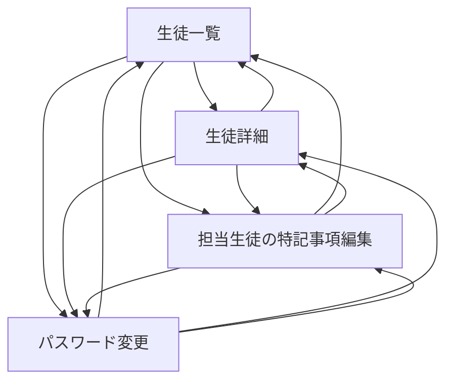

# UIデザイン変更

2026年10月23日。対象は生徒・講師管理アプリの共通レイアウト、一覧、フォーム、詳細、ログイン、パスワード関連画面、共通エラー画面。利用者が提示した管理画面の参考画像を基に、以下の外観と操作を採用する。配置先・DB名は従来どおり `βteam` とする。

## 外観と画面構成

| 部分 | 採用する内容 |
|---|---|
| 左上のタイトル | 「学習塾の生徒・講師管理」の文字のみ。βロゴ・βteamの画面表示・ファビコンを撤廃 |
| サイドバー | PCでは幅248px、背景 `#333333`。講師名・権限、生徒情報、許可された権限の講師情報、パスワード変更、ログアウトを配置 |
| 上部バー | 高さ64px、背景 `#262626`。画面名を表示 |
| 本文 | 白を基調とし、検索・一覧・行の操作を見分けやすく揃える |
| 主要ボタン | 青 `#1976d2`。新規登録・保存等に使用。検索・キャンセルは白い補助ボタン |
| 行の操作 | 詳細への経路と、権限に応じた編集を表示。編集はアイコンに文字を添える |
| フォーム・詳細 | 既存の入力項目と操作を維持し、共通の色・余白・部品を適用 |
| ログイン・エラー | 同じテキストタイトルを表示。共通エラー画面はDB接続や利用者情報の取得に依存しない |

参考画像の学校設定、年度設定、一括処理、通知、ダッシュボード等は追加しない。削除は既存の編集画面から確認モーダルを開き、対象氏名と取り消せないことを確認して行う。

サイドバーは権限に応じて表示する。generalには講師情報への入口を表示せず、operatorには講師の登録・編集・削除を表示しない。初回パスワード変更中は通常の生徒・講師メニューへ進ませない。サーバー側の認証・権限制御も維持する。

## 一覧検索

一覧上部は検索フォームを左、新規登録を右に配置する。新規登録は権限がある利用者に表示する。

| 一覧 | 検索対象 | 表示範囲 |
|---|---|---|
| 生徒 | 生徒氏名、担当講師氏名 | 全権限で閲覧可能な全生徒 |
| 講師 | 講師氏名、メールアドレス | adminは全講師、operatorはoperator・generalのみ |

検索は100文字以内の語による部分一致とし、GETパラメーター `q` で受け付ける。サーバーで閲覧可能な全件を検索してから、ID昇順・20件ごとにページ分割する。複数の担当講師が一致しても生徒は1行だけ表示する。ページ切替では `q` を保持し、検索条件を変えたときは先頭ページへ戻す。検索結果0件では検索条件を見直すか解除する経路を示す。

一覧からパスワード変更へ進んだ場合、変更成功後は検索語とページ位置を保持して元の画面へ戻り、完了メッセージを表示する。戻り先の許可リストと権限確認を維持する。

## 狭い画面・キーボード操作

狭い画面ではメニューボタンからナビゲーションを開閉し、開いた内容が本文を下へ押し出す。画面全体を覆うモーダルにはしない。開閉状態をボタンの `aria-expanded` で示し、Escで閉じたときはボタンへフォーカスを戻す。JavaScriptが無効ならナビゲーションを常時表示する。

フォーム・詳細は1列へ切り替え、長いメールアドレスや特記事項を折り返す。表は必要に応じて横スクロールできるようにする。入力欄のラベル、必須表示、エラー要約へのフォーカス、項目別エラー、409時の最新画面へのリンク、削除確認のキャンセルへの初期フォーカスと終了後の復帰を維持する。

## 設計判断

- SHIG [#59「ウェイファインディング」](https://www.sociomedia.co.jp/9623)：共通サイドバーと画面名で現在地を示し、一覧へ戻る経路を揃える。
- SHIG [#60「エスケープハッチ」](https://www.sociomedia.co.jp/9627)：メニューをEscで閉じて元のボタンへ戻れ、削除確認やフォームをキャンセルできるようにする。
- SHIG [#55「エラー表示は建設的にする」](https://www.sociomedia.co.jp/9535)：検索0件や入力エラーでは次に取れる操作を示し、入力値と回復リンクを保つ。
- SHIG [#66「操作の近くでフィードバックする」](https://www.sociomedia.co.jp/9729)：保存・削除・パスワード変更後の完了表示を維持する。

## 検証結果

PHP 8.2.35、専用MariaDB 10.4.32、Chromiumの独立環境で確認した。実DBや実アカウントは使用していない。検索のページング確認には合成の生徒・講師を各35件用意し、25人の生徒へ2人ずつ担当講師を割り当てた。

| 確認 | 結果 |
|---|---|
| PHP単体・エラー単体 | 40件＋25件成功。検索付きの戻り先と不正な検索語の除外を追加検証 |
| 既存HTTPセキュリティ回帰 | 108/108件成功。試験データの復元一致を確認 |
| ブラウザーの系統確認 | 98/98検証成功、JavaScript例外・資材取得失敗0件 |
| キーボードの追加確認 | 6/6検証成功。スキップリンク、PCメニュー開閉、削除確認内のTab移動・狭い画面の幅を確認 |
| 表示 | 1440px・390px・320pxと文字200%で確認。タイトル文字のみ、空のファビコン、ページ全体の横はみ出しなし。表内の横スクロールは維持 |
| 権限 | admin・operator・generalと初回変更中のメニューを確認。operatorの講師検索は25件中17件で、adminは表示しない |
| 検索 | 氏名、メール、担当講師名、部分一致、25件の20＋5件表示、重複なし、0件と解除、101文字・配列・不正UTF-8の400、HTML・SQL風文字・%_の文字通りの検索を確認 |
| 状態の保持 | ページ切替の検索語保持、検索時の先頭ページ復帰、パスワード変更成功後の検索語・ページ・完了表示を確認 |
| 入力と回復 | 生徒登録・保存・削除と成功表示、入力値・項目別エラーの保持、競合時のフォーカス・最新画面リンク、削除確認のキャンセル初期フォーカス・Esc復帰を確認 |
| 狭い画面 | メニュー開閉、本文を下へ押す配置、Escで閉じる・ボタンへフォーカス復帰、1列フォームを確認 |
| JavaScript無効 | ナビゲーション常時表示、検索、ログアウトを確認 |

ブラウザー確認の初回は試験コードが編集用・削除用の2つのversion欄を区別せず停止した。編集フォーム内へ対象を限定して再実行し、98件すべて成功した。表示確認では検索欄の余白に共通入力欄のCSSが優先する問題を修正し、アイコンと入力文字が重ならないことを再検証した。

### 画面遷移・ランダム操作

一般講師の専用セッションで、系統巡回とseed42のランダム操作を実施した。

| 幅 | 巡回画面／遷移 | ランダム操作 | 記録 |
|---|---|---|---|
| 1280×800 | 15画面／151遷移、未到達0、デッドエンド0 | 300操作、24URL | 通信中断87件。HTTP・JavaScript・コンソールエラー0件 |
| 390×844 | 40画面／349遷移、デッドエンド0 | 300操作、24URL | 通信中断55件。HTTP・JavaScript・コンソールエラー0件。探索上限による未到達3件 |

通信中断はすべて`net::ERR_ABORTED`で、連打や履歴移動で進行中のリクエストが中断された記録。試験を「記録0件」とは扱わない。mobile巡回途中で別の検証用生徒が追加されたため、PCとmobileの画面数は直接比較しない。探索維持のためランダム操作からログアウトを除外したが、別の系統確認で実際のログアウトを検証した。

巡回スクリプトはID・ページ・検索語のクエリ保持、モーダル内と操作可能な要素への候補限定、入力型別操作を適用した。系統巡回・ランダム操作は4回とも終了0。取得した一覧・詳細・特記事項編集・通信中断時の画像を開いて確認した。

この図は一般講師の到達経路を画面の種類でまとめたもの。個別ID・ページ・検索条件を含む全遷移はローカルの`output/playwright/monkey-*/transitions.json`へ保存した。操作履歴・通信中断・スクリプト差分と再現コマンドは`output/playwright/monkey-summary.json`、系統確認は`output/playwright/ui-browser.json`、回帰試験は`output/ui-redesign/security-http.json`。これらは試験成果物としてGitの対象外とする。

代表画像（ローカル）：[PC一覧](../output/playwright/teachers-desktop.png)、[狭い画面](../output/playwright/teachers-mobile.png)、[生徒登録](../output/playwright/student-create-mobile.png)、[メニュー展開](../output/playwright/menu-mobile.png)、[入力エラー](../output/playwright/input-error-desktop.png)、[競合](../output/playwright/conflict-desktop.png)、[削除確認](../output/playwright/delete-dialog-desktop.png)、[パスワード変更後](../output/playwright/password-success-desktop.png)。全画像の索引は`monkey-summary.json`にも収録した。

## 未確認の範囲

外部SMTPを使った認証コード入力画面の実送受信は今回のUI試験では実施していない。既存の認証・送信処理を維持して共通レイアウトとCSSを適用した。共有XAMPPのPHP更新・Apache再起動と実DBの変更は今回も対象外。

差分を自己レビューし、検索欄のCSS優先順位に関する指摘を受け入れて修正・再検証した。未修正の必須指摘はない。機能に影響しない資料変更については差分・ローカルリンクの整合性を確認した。
