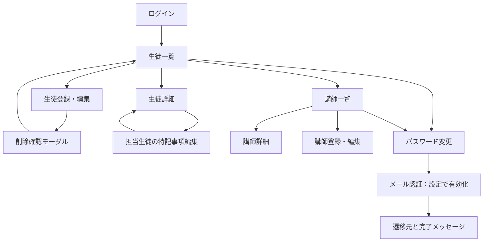

# 実装・検証結果

2026年10月21日。以下のアプリ検証は仕様書0.5を対象とし、XAMPPのPHP 8.2.12、MariaDB 10.4.32、Apache 2.4.58。

## 実装範囲

- DB本体を自動生成しないテーブル定義 `database.sql` と、7テーブルの設計書を作成。
- ログイン、30分の無操作期限、ログアウト、初期adminのCLIセットアップ。
- admin・operator・generalのサーバー側権限制御。
- 生徒の一覧・詳細・登録・編集・削除、担当講師の複数選択。
- generalによる担当生徒の特記事項だけの編集。担当解除時の再確認と編集競合の検出。
- 講師の一覧・詳細・登録・編集・削除。operatorにはoperator・generalだけを表示。
- 担当生徒がいる講師、自分、最後のadminを保護する管理処理。
- パスワードポリシー、初回変更、変更後のログイン維持と遷移元への完了表示。
- 設定で有効にできるSMTPメール認証、6桁コード、10分期限、5回の誤入力制限、60秒の再送間隔、1時間5回の送信制限。
- PC・スマートフォン表示、削除確認モーダル、入力エラー・空データ・接続失敗の表示。

機能ごとにGitHubへpush済み。データベースの初期定義、認証、生徒管理、講師管理、メール認証、画面確認の修正を別コミットとしている。

## 自動確認

既存のXAMPP DBを使わず、一時データフォルダーのMariaDBと別ポートのPHPサーバーで実施した。データは架空の氏名とexample.invalidドメインを使用。SMTPは外部へ配送しないローカル受信先を使用した。

| 確認対象 | 確認数 | 結果 |
|---|---:|---|
| 共通処理 | 31 | 通過。パスワードの長さ・文字種類、HTML出力、戻り先、日付、Unicode URLのCookieパス |
| 認証・初期設定 | 17 | 通過。初回変更、CSRF、ログアウト、平文保存の防止 |
| 生徒管理 | 24 | 通過。多対多、権限外更新、担当解除、古い版の更新、削除 |
| 講師管理 | 22 | 通過。権限別表示、直接アクセス、初期パスワード、削除制限 |
| メール認証 | 27 | 通過。再送、旧コード拒否、期限切れ、誤入力上限、送信失敗、元画面への復帰 |
| βteamでの配置 | 4 | 通過。分離DB内のβteam名でのPHP接続と、/βteam/ URL配下での認証保持 |
| 最終修正の再確認 | 6 | 通過。自分のメール変更後のログイン保持、別セッションでも維持されるログイン回数制限 |
| 合計 | 131 | すべて通過 |

全PHPファイルで構文確認を実施した。設定ファイル・SMTP認証情報・ログインCookieはGitへ含めていない。

## 画面遷移とランダム操作

| 権限・画面幅 | 巡回画面数 | 遷移数 | 巡回時のJS例外・コンソールエラー | 未到達リンク |
|---|---:|---:|---:|---:|
| admin・PC | 28 | 282 | 0 | 0 |
| operator・PC | 22 | 222 | 0 | 0 |
| general・スマートフォン | 16 | 144 | 0 | 0 |

標準の巡回スクリプトはログアウトを押して認証を失い、IDのクエリも除去するため、そのままではログイン後の画面を十分に確認できなかった。作業用コピーでID・ページ引数を保持し、ログアウトを巡回対象から外した。ログアウト自体は上記の認証シナリオで別途確認済み。ランダム操作の入力種別も日付・チェックボックスに対応させ、モーダルが開いているときはその中を操作対象とした。

adminはseed 42・PC幅で300回、generalはseed 73・390×844で300回のランダム操作を完了した。到達URLはそれぞれ30件、31件。記録した通信中断はadminで68件、generalで78件で、すべて `requestfailed / net::ERR_ABORTED`。連打や履歴移動で読み込み中の要求が中断された記録であり、JS例外やHTTPエラーレスポンスは記録されなかった。これらのログを0件として扱ってはいない。[中断記録時の代表画面](検証/画面/navigation-abort-example.png)にもアプリのエラー表示はなかった。

実行例は `node monkey.mjs --url http://127.0.0.1:33319/students.php --out <出力先> --events 300 --seed 42 --viewport desktop --storage-state <検証用状態>`。認証状態と検証用一時DBが必要で、実DBに対する実行は避ける。

初回のランダム操作は、画面外の本文スキップリンクへのクリックでタイムアウトしたため停止した。スキップリンクはキーボードでフォーカスしたときだけポインター操作もできるよう修正し、再実行を完了した。Tabでリンクを表示し、Enterで本文へフォーカスが移ることも個別に確認した。

表示する入口は権限により異なる。削除モーダルはURLを増やさない。generalは講師一覧へ進めない。

## 画像で確認した点と修正

- [ログイン](検証/画面/login.png)：入力ラベル、パスワード表示切替、認証エラーの表示領域を確認。
- [PCの生徒一覧](検証/画面/students-desktop.png)：複数の担当講師が表示され、詳細・編集への入口を揃えた。
- [講師フォーム](検証/画面/teacher-form.png)：権限を選択式にし、初期パスワードの条件を入力欄の近くに表示。
- [削除確認](検証/画面/delete-dialog.png)：対象氏名を表示し、キャンセルを初期フォーカスとした。Escで閉じ、元の削除ボタンへフォーカスが戻ることを確認。
- [スマートフォンの一覧](検証/画面/students-mobile.png)：氏名が一文字ずつ折り返される表示を修正し、横スクロールの案内を追加。フォームは1列表示。

判断基準はSHIG #39（選択による整合性）、#55（修正方法のあるエラー）、#59（現在地と戻る導線）。出典は仕様書に記載。

## 配置先のXAMPPでの確認

このPCのApacheは8080番、DB設定は3307番。80番のlocalhostはIISで、XAMPPとは別のサーバーだった。起動URLは [http://localhost:8080/βteam/login.php](http://localhost:8080/%CE%B2team/login.php)。

指定のhtdocsへ同期後、実際のApacheでログイン画面・CSS・アイコンが200、SQL・設定の見本・docs・同梱ライブラリ・Git情報・Web経由の初期管理者作成が403になることを確認した。Apache設定は変更していない。実DBへの作成・変更も行っていない。

## 自己レビュー

修正後の実装で未対応の[must]指摘はなし。確認中に次を修正した。

- [受ける] UnicodeフォルダーのCookieパス：URLへ合わせたエンコードとWindowsの区切り文字に対応。分離環境で実際のログインを確認。
- [受ける] 自分のメール変更時のセッション更新：DBのコミット成功後に反映し、失敗時のセッションとの食い違いを防止。HTTPで再確認。
- [受ける] 不正な日付文字列：日付解析前に形式を確認し、NULL文字を含む入力も通常の入力エラーにする。単体確認を追加。
- [受ける] スマートフォンの氏名折り返し、アイコン404、スキップリンクの操作対象：修正して画像・キーボード操作で再確認。

## 前提・未確認事項

利用者が実DBを作成し、database.sqlのインポート、config.local.phpの接続設定、初期管理者の作成を行う必要がある。実際のSMTPサービスを使う送信・受信と、別のPCへの復元は未確認。MySQL 8.0本体では実行しておらず、実行確認はMariaDB 10.4.32で行った。パスワード忘れの再設定画面、講師別メモ、監査履歴は実装対象外。提出用の最終SQLエクスポートとZIPはチームで作成する。

## SQLテスト・資料整理の追加（仕様書0.6）

7テーブル各10件、合計70ケースのSQLテストを追加し、独立したMariaDBで2回とも全件成功しました。共通処理31件も再実行して成功。生成SQLの件数、講師10人のパスワードハッシュ照合、専用DB以外を拒否する動作を確認しました。詳細は[SQLテストケース](SQLテストケース.md)を参照してください。

Markdownをdocsへ移動し、SQL・各自の設定・ログ・一時ファイルをGit管理外にしました。既存の検証記録・画面画像・PHPソース・ライブラリは保持しています。SQLのローカルファイルは残し、Gitの追跡だけを解除しています。詳細は[Git管理方針](Git管理方針.md)を参照してください。
